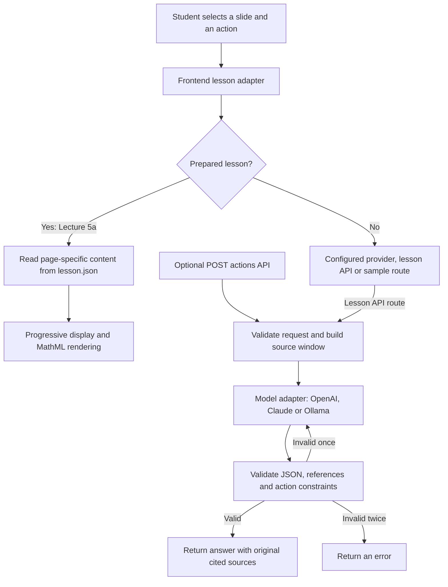

# Katchup architecture

Katchup receives a slide number and one of three actions: recover context, explain the slide or define its terms. It uses local lecture materials, with optional transcript segments. The Lecture 5a frontend retrieves page-specific content and renders text, formulas, symbol definitions and prerequisite links. The optional model-backed agent selects an allowed source window, calls an OpenAI, Claude or Ollama adapter, validates the answer and retries invalid output once. Its operations are local retrieval, source selection, model completion and validation; it cannot search the web or run arbitrary tools. It returns either an answer with cited sources, an explicit indication of missing context, or an error. Application code controls this workflow, including rejection of future transcript cutoffs and unavailable citation IDs.

## Two implemented execution paths



The shipped Lecture 5a interface uses the prepared path. It permits browsing all 62 pages. The optional model-backed API is separately runnable and enforces a source window ending at the selected slide. The browser's direct-provider path has its own prompts and does not use the backend's structured-output validator.

## Input

| Input | Where it comes from | How it is used |
| --- | --- | --- |
| Slide number | Navigation, slide selector or `?start=N` | Selects the page and its local glossary |
| Action | Katchup, Explain this slide or Glossary | Maps to `context`, `explain` or `glossary` |
| Lecture materials | Local JSON, PDF and page images | Provides the knowledge and display assets |
| Transcript cutoff | Optional API request | Limits which whole-slide transcripts enter the prompt |
| Provider configuration | Optional `.env` or non-prepared browser settings | Chooses the model endpoint and credentials |

Example model-backed request:

```json
{
  "action": "context",
  "slideNumber": 2,
  "transcriptThroughSlide": 1
}
```

There is no free-text chat box. Natural-language requests in the example scenarios describe the student's intent; the actual interaction is a selected page plus an action.

## Knowledge

The main knowledge file, `web/lesson/lesson.json`, contains 62 original slide texts and page images, English context and explanations, 314 page-specific glossary entries, 718 symbol definitions, and links to prerequisite pages. Symbols are scoped to each page so notation can retain its local meaning. Lecture 5a has no supplied speech transcript, so its transcript fields are empty.

The optional API reads manifests with slide text and transcript segments. For selected slide N, `buildContext` includes slide text 1 through N and transcripts through the requested cutoff, defaulting to N minus 1. Future slides are excluded before the model call. This is a deterministic source window, without embeddings, a vector database or similarity search. It rejects contexts above 65,000 characters rather than silently truncating them.

## Available operations and tools

These operations are orchestrated by JavaScript. They are not model-selected function calls.

| Operation | Implementation | Availability |
| --- | --- | --- |
| Load and validate lesson data | `web/app/lesson/load.mjs` | Browser demo |
| Retrieve local notes and definitions | `createLessonApi` in `web/app/api/lesson.mjs` | Browser demo |
| Navigate prerequisites and open the PDF | `web/app/main.mjs` | Browser demo |
| Load an API lecture | `LectureStore` in `src/lectures/store.mjs` | Optional API |
| Select allowed sources | `buildContext` in `src/agent/context.mjs` | Optional API |
| Request a model completion | `complete({ system, user, schema })` in `src/llm/adapter.mjs` | Optional API |
| Check answer structure and citations | `parseAnswer` in `src/agent/output.mjs` | Optional API |

The agent has no web-search, shell, email, arbitrary file-write or microphone tool. Importing a lecture is a separate developer command, not an agent action.

## Decisions and custom logic

1. **Route:** prepared content takes priority over saved provider settings. Other lessons can use a configured provider, a matching backend lecture or the built-in sample.
2. **Scope:** the API accepts only three actions and a transcript cutoff no later than the selected slide. Materials are presented to the model as data, never as instructions.
3. **Answer shape:** context permits at most 3 points; explanation at most 5; glossary at most 8 terms that occur on the current slide. Every point or term must cite an available source ID.
4. **Validation and repair:** invalid model output triggers one correction attempt. A second invalid answer returns `INVALID_LLM_OUTPUT`. Provider network failures are not retried automatically. `insufficient_context` is supported and must identify the missing information.
5. **Presentation:** the two left panels are mutually exclusive. Glossary symbols are immediately visible. Local answer text appears in small chunks, preserving complete mathematical expressions and bold spans. Reduced-motion preferences skip the animation.
6. **Cancellation:** closing a panel or changing slides aborts its ongoing reveal. Request tokens and slide checks prevent late results from appearing on a different page. Reopening a prepared panel restarts the reveal.

## Output

The prepared path returns Markdown text for context or explanation, or glossary entries and a symbol legend. The UI escapes text, converts supported notation to native MathML and adds links to local terms and earlier pages.

The model-backed API returns this shape, with real source text attached for review:

```json
{
  "lectureId": "agent-check",
  "slideNumber": 2,
  "action": "context",
  "transcriptThroughSlide": 1,
  "status": "ok",
  "summary": "Distinguish a one-step reward from a return.",
  "points": [
    {
      "text": "A reward is numerical feedback from one step, not the entire future of a trajectory.",
      "sourceIds": ["transcript:1"]
    }
  ],
  "terms": [],
  "missingContext": [],
  "sources": [
    {
      "id": "transcript:1",
      "kind": "transcript",
      "slideNumber": 1,
      "text": "A reward is numerical feedback from one step. It does not describe the entire future of a trajectory."
    }
  ]
}
```

This output is reproduced by the example runner using a fixed adapter response and the real agent pipeline.

## Boundary and current scope

The API rejects future transcript cutoffs before contacting a model. It also rejects future or nonexistent citation IDs after generation. These are enforced code paths, demonstrated in the [example interactions](example-interactions.md).

Citation validation proves that a source exists in the allowed window; it does not prove that every claim follows from that source. The English-only and lecture-only instructions are prompts, not a formal semantic verifier. No live inference, general jailbreak evaluation, speech recognition, automatic PDF ingestion or model training is claimed for this delivery.
